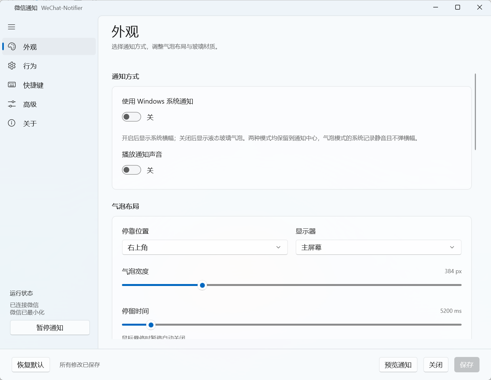

# WeChat-Notifier

WinUI 3 微信通知工具。它在本机读取微信会话摘要与未读数，并通过 Windows 通知中心、Windows 横幅或液态玻璃气泡提醒新消息。

## 软件截图




## 工作原理

### 本地检测新消息

程序只读微信本地的 `session.db`、`contact.db` 和可用的 `bizchat.db`，用于获取会话摘要、未读数、联系人名称、群成员名称和免打扰状态；**不会打开微信完整消息数据库**。通知内容由会话摘要生成，聊天内容不会上传。

程序监听这些数据库及其 `-wal`、`-shm` 文件的变化。文件事件会合并处理：静默 125 毫秒后读取，持续写入时最多等待 1 秒。默认每 3 秒轻量检查一次 SQLite 提交状态；状态未变时不重新查询会话。提交变化后才读取一致快照，并按会话 ID 和消息摘要判断是否有新消息。联系人和企业会话信息按数据库提交版本缓存；同一 WAL 代次可以增量应用新提交页。

首次连接、微信重启、切换账号或从长时间挂起恢复时，程序会重新建立基线，不把已有历史未读补发成新通知。

### 通知如何出现和更新

1. 会话状态有变化时，程序根据会话名称、最新摘要、时间和群成员名称生成通知；默认只在未读数增加时提醒。
2. 行为设置先过滤免打扰会话、忽略名单和公众号等；微信在前台时默认忽略消息，不会在离开前台后补发。
3. 通知模式决定临时横幅或气泡显示什么内容；通知中心始终单独保存会话详情。
4. 同一会话在通知中心只保留一条记录。`[N条]` 是数据库中的当前未读总数；大于 1 时会显示在最新摘要前。该会话未读数归零后，程序撤回这条记录。

临时横幅或气泡也会在同一会话的上一条临时通知仍存在时合并消息数并更新最新摘要。临时通知结束后，下一条消息重新开始计数。隐私模式会把临时内容隐藏为“收到了 N 条消息”，但通知中心仍保留上述详细内容。

## 通知方式与模式

“使用 Windows 系统通知”决定临时通知使用 Windows 横幅还是应用内液态玻璃气泡；关闭它不会关闭 Windows 通知中心记录。正常和隐私模式都会按此设置选择横幅或气泡，静默模式不显示临时通知。Windows 横幅的屏幕显示时长由 Windows 管理；应用内气泡默认显示 5.2 秒，鼠标悬停时暂停关闭。

| 模式 | 托盘图标 | 临时横幅 / 气泡 | Windows 通知中心 |
| --- | --- | --- | --- |
| 正常 | 绿色 | 显示会话名称、最新摘要和累计条数 | 每个会话一条详细记录，显示未读条数与最新摘要 |
| 隐私 | 蓝色 `#4E6EF2` | 只显示“收到了 N 条消息” | 与正常模式相同，保留详细记录 |
| 静默 | 黑色 `#28282B` | 不显示 | 与正常模式相同，保留详细记录 |

三种模式都会显示托盘未读角标，最多显示 `99+`。默认只要还有未读就持续闪烁；行为设置可关闭持续闪烁并设置单次时长，默认 6 秒。闪烁每 500 毫秒切换一次；清零未读数后停止。双击托盘图标通过已配置的微信热键唤起微信并清零托盘角标；通知中心记录会在对应会话实际变为已读后撤回。

### 模式切换

- 默认使用 `Ctrl+Alt+,+.` 在正常 → 隐私 → 静默 → 正常模式间循环切换；快捷键可以在设置中录制或更改。右键托盘菜单也可以从模式二级菜单直接选择，一级菜单标题显示当前模式。
- 模式切换提示是最多 1.5 秒的本地气泡，不写入通知中心。切换到隐私或静默模式时，程序会关闭旧的详细横幅，同时保留通知中心里的详细记录。
- 行为设置可将 EXE 加入隐私或静默名单。程序约每秒检查名单中的运行程序；静默名单优先级高于隐私名单。名单程序退出后恢复手动选择的模式。自动模式切换提示可以关闭。

### 通知过滤和托盘计数

- 默认开启“微信在前台时不打扰”：检测时或投递时微信在前台，消息会被忽略且不补发。微信未运行时也不会产生通知。
- 默认开启“全屏应用运行时不打扰”：新消息仍写入通知中心并更新托盘，临时横幅或气泡不显示。
- 默认跳过免打扰会话，并只在未读数增加时通知；关闭“仅未读数增加时通知”后，会话摘要变化也可以触发通知。公众号默认不包含。可以在行为设置中更改这些规则、名单和关键字过滤。
- 暂停通知期间不会积累待补发消息；恢复时只建立新基线。程序启动前已有的历史未读也不会计入托盘新消息角标。

## 运行与配置

- `Config/config.json`：配置保存在程序目录；安装版默认位于 `%LOCALAPPDATA%\Programs\WeChat-Notifier`。首次启动自动生成配置。
- `Log/app.log`：日志位于同一数据根目录；单个日志文件达到 2 MiB 时滚动，最多保留 14 个文件。
- 设置窗口点击“保存”后应用修改；关闭设置窗口只隐藏到托盘。托盘右键“设置…”打开主界面，“退出”才停止程序。
- “不再提示”立即保存，不会顺带保存设置窗口中尚未提交的其他修改。
- 普通单文件的临时解包目录只用于依赖和图标，不用于配置或日志。便携版运行目录不可写时会报错，不回退到其他目录。旧用户目录的配置不会自动覆盖新配置，需要时自行复制到 `Config/config.json`。

## 项目结构

```text
src/WeChat-Notifier.App/
├─ App.xaml / Program.cs      启动与组装
├─ Configuration/             配置模型、JSON 与运行路径
├─ Domain/                    通知内容、会话与窗口状态
├─ Application/               应用协调与通知规则
├─ Infrastructure/
│  ├─ WeChat/                 微信状态、数据库读取
│  ├─ Windows/                托盘、热键、Win32 互操作
│  ├─ Notifications/          Windows 通知适配
│  └─ Logging/                日志
├─ Views/                     设置页、控件与气泡渲染
├─ ViewModels/                设置工作副本与编译绑定
├─ Diagnostics/               自测与诊断入口
└─ Build/                     简中 MUI、PRI 裁剪
```

## 构建与发布

使用 PowerShell 7 和 .NET 10 SDK：

```powershell
./build.ps1                       # 简中、自包含、裁剪单 EXE
./build.ps1 -Architecture arm64   # ARM64 单 EXE
./build.ps1 -Aot                  # x64 Native AOT
./build.ps1 -Architecture arm64 -Aot
```

Native AOT 需要 Visual Studio C++ 构建工具和 Windows SDK；WinUI / Windows App SDK 运行文件仍随程序一起发布，因此 AOT 输出包含 EXE 和运行依赖文件。

推送符合 `vMAJOR.MINOR.PATCH` 的 tag 会触发 GitHub Actions，分别构建 Windows AOT x64 与 ARM64。Release 附带两种架构的便携压缩包，以及架构专用 Inno Setup 安装程序：`WeChat-Notifier-Setup-x64.exe` 和 `WeChat-Notifier-Setup-arm64.exe`。双击对应安装程序即可安装，不需要导入证书。

自测入口为 `WeChat-Notifier.exe --selftest`，界面验证入口为 `--ui-smoke`。`--mode-smoke` 使用实际 EXE、热键和系统通知验证模式切换，并将结果写入 `Log/mode-smoke`。构建脚本不会把已有的 `Config/Log` 内容打进压缩包。

原配置字段 `PollIntervalMs` 保持兼容，现在表示轻量提交状态核对间隔，而不是固定查询间隔。`--probe-wechat` 可在 12 秒内只读检测当前数据库，输出查询次数、CPU 时间和事件触发次数；不会发送微信消息或触发通知。
